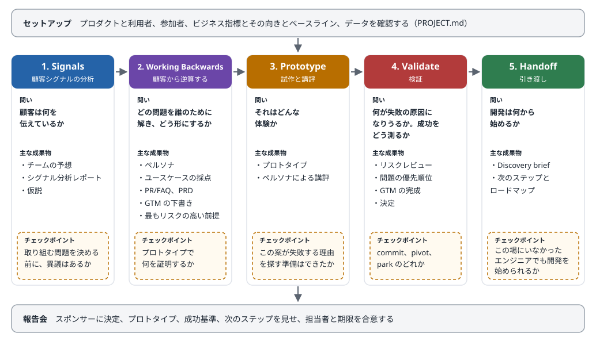
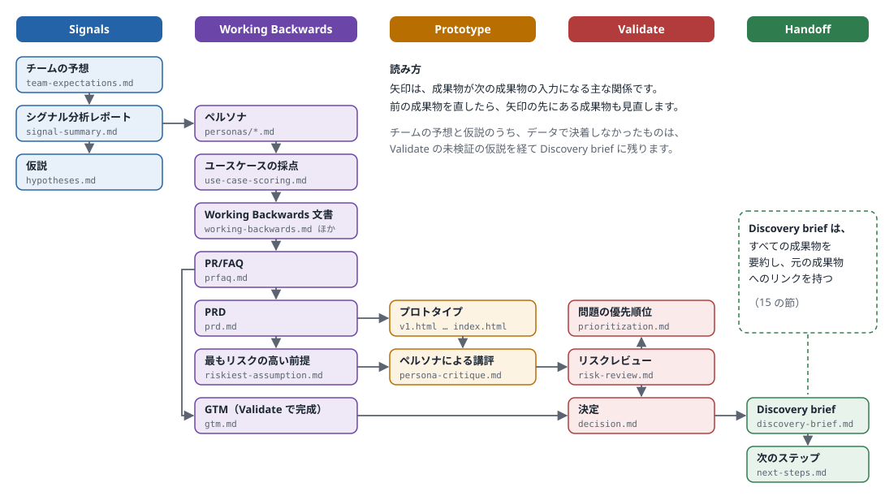

# この PR/FAQ、本当に自分たちの言葉ですか？ AI-DLC Discovery で作る成果物の読み方

AI-DLC Discovery では、AI アシスタントがフェーズごとに何本もの文書を下書きします。顧客の声の分析、ペルソナ、ユースケースのスコア、プレスリリース、要求仕様、リスクの評価、開発への引き継ぎ文書。どれも数分で、それらしい形でできあがります。

けれど、それをそのまま受け入れたら、その文書は AI の意見のままです。チームが読み、異議を出し、書き直したときに、はじめてチームの決定になります。

この記事では、AI-DLC Discovery の各フェーズで作る成果物を一つずつ取り上げ、何が書いてあるか、どこを見ればよいか、どんな落とし穴があるかを紹介します。AI-DLC Discovery の目的や方法論、各フェーズで考えるべきことは、「[作る前に、プレスリリースを書こう。顧客の声から『最初に作るもの』を決める AI-DLC Discovery 入門](ai-dlc-discovery-intro.md)」で紹介しています。

**この記事で分かること**

- AI-DLC Discovery の成果物の全体像と、成果物どうしの関係
- すべての成果物に共通する読み方
- フェーズごとの成果物の内容、位置づけ、作る目的
- それぞれの成果物をレビューするときに見るところ

## 1. おさらい: 全体の流れと成果物

AI-DLC Discovery は、セットアップのあと、5 つのフェーズを順に進みます。Signals（顧客シグナルの分析）で顧客の声を聞き、Working Backwards（顧客から逆算する手法）で取り組む問題を決めて形にし、Prototype で触れるものを作り、Validate（検証）で失敗の原因を探してから決め、Handoff（引き渡し）で開発に渡します。各フェーズの終わりのチェックポイントで、チームが確認してから次に進みます。



*図 2-1: AI-DLC Discovery の全体の流れ*

成果物は、フェーズごとのフォルダに保存されます。

```text
discovery/
├── data/                 生のデータ（バージョン管理に入れない）
└── [project]/
    ├── PROJECT.md        範囲、選んだこと、フェーズの状態
    ├── signals/          Signals の成果物
    ├── working-backwards/  Working Backwards の成果物
    ├── prototype/        Prototype の成果物
    ├── validate/         Validate の成果物
    └── handoff/          Handoff の成果物
```

`PROJECT.md` は、AI-DLC Discovery の起点になるファイルです。セットアップで確認したこと（プロダクトと利用者、参加者、ビジネス指標とその向きとベースライン、データ、プロジェクト言語）と、各フェーズの状態が書かれています。別のセッションで続きから再開するときも、アシスタントはこのファイルを読みます。セットアップでは、特にビジネス指標と、それが上がるとよいのか下がるとよいのかを確かめてください。このあとのすべてのスコアが、この指標を基準につけられます。

成果物は、前の成果物を入力にして作られます。



*図 2-2: 成果物の依存関係*

この関係を知っておくと、レビューで見つけた問題の影響範囲が分かります。たとえば、ペルソナを直したら、採点、PR/FAQ（Press Release / Frequently Asked Questions。発売時のプレスリリースと、想定される質問への回答をまとめた文書）、講評も見直しが必要です。前のステップの決定を直すと、アシスタントは影響を受けるステップのやり直しを提案します。

## 2. 成果物を読む前に: すべての成果物に共通する読み方

### エビデンスラベル

成果物の主張には、エビデンスラベルがつきます。レビューでは、まずラベルを見ます。

| ラベル | 意味 | 例 | レビューでの扱い |
|--------|------|-----|------------------|
| **Known**（データで裏付けあり） | 件数、引用、指標など、データが示している | 「400 件中 102 件のフィードバックが、この問題に触れている」 | 数字が何の何件中かを示しているか、範囲を広げすぎていないかを見る |
| **Assumed**（仮定） | そう考えているが、データでは示されていない | 根本原因の仮説、チームの経験にもとづく判断 | 判断に関わるなら、検証の計画があるかを見る |
| **Needs evidence**（要エビデンス） | 判断に関わるので、検証が必要 | プロトタイプの画面に入っているが、誰も確認していない機能 | 担当者と期限がついているかを見る |

PR/FAQ のプレスリリースは、報道記事として読めるように、**Assumed** と **Needs evidence** の主張にだけラベルがつきます。そのほかの成果物では、主張ごとにラベルがつきます。

### 英語のまま残る部分

日本語で進めると、成果物の本文は日本語で書かれます。ただし、次のものは英語のまま保存されます。後のステップと、引き継ぎ先の AI 駆動開発ライフサイクル（AI-DLC、AI-Driven Development Lifecycle）が、この形を読むためです。

- 成果物のテンプレートの見出し（`## Top signals`、`## Readiness check` など）
- 値の前のラベル（`Verdict:`、`**Decision:**` など）と、テンプレートが決めている表の見出し
- 選択肢の値（GREEN、AMBER、RED、HIGH、MEDIUM、LOW など）
- 方法論の名前、エビデンスラベル、commit、pivot、park といった決定の値

見出しが英語でも、その下の本文が日本語になっていれば正しい状態です。

### 顧客の引用

顧客の発言は、名前やアカウントなどの情報を除いて引用されます。フィードバックが英語などほかの言語で書かれている場合は、日本語の訳、原文、出典が並びます。訳が原文より強く、または弱くなっていないかを確かめてください。訳には、原文にない意味を足しません。

### 合成されたペルソナの言葉

ペルソナは、顧客データから作った合成の人物です。ペルソナの発言、プレスリリースの「顧客の声」、プロトタイプの講評は、顧客のエビデンスではありません。仮説として読み、実際の利用者で確かめる対象にします。

### 下書きと決定

チームが確定するまで、アシスタントが書いたものは下書きです。特に、理由、目標値、撤退基準、担当者など、本来チームが決めることをアシスタントが書いている場合は、確定するか、変えるか、提案であると明記します。開発に渡ると、それはチームが決めたこととして読まれます。

### どの成果物にも共通するレビュー観点

- 数字が、何の何件中かを示しているか。
- 1 社、1 か月、1 つの引用の数字を、顧客全体の事実のように書いていないか。
- アーキテクチャや技術の選定が書かれていないか。それは開発が決めることです。
- 「革新的な」「シームレスな」のような誇張表現や、根拠のない「初の」がないか。
- 自分たちの顧客と自分たちのプロダクトについて書かれていると感じられるか。

## 3. Signals の成果物（`signals/`）

Signals は、チームの思い込みを記録し、顧客の声をデータで確かめるフェーズです。ここで作る成果物は、このあとのすべての判断の根拠になります。

| 成果物 | ファイル | 位置づけと作成目的 | 後で読むステップ |
|--------|----------|--------------------|------------------|
| チームの予想 | `team-expectations.md` | 分析前の思い込みを記録し、データと照らし合わせる | シグナル分析レポート、仮説 |
| シグナル分析レポート | `signal-summary.md` | 上位の顧客の問題を、件数と引用つきで示す | ペルソナ、採点、PR/FAQ、Discovery brief |
| 仮説 | `hypotheses.md` | データが残した問いを、検証の計画にする | Validate、Discovery brief |

### チームの予想

**何が書いてあるか。** 分析を見る前にチームが挙げた予想が、E1、E2 … の番号つきで、チームの言葉のまま書かれています。形は「〔誰〕が〔問題〕を抱えると予想する、なぜなら〔チームが見てきたこと〕」です。予想がなかった場合は、その旨が 1 行で書かれます。分析のあとは編集しません。

**レビュー観点**

- 分析の前に書かれているか。
- 一つひとつが、データで間違いだと示せる 1 文になっているか。
- 言った人の言葉が、アシスタントに「改善」されていないか。

**落とし穴:** 分析のあとで予想を書き足したり、言い換えたりすると、照合の意味がなくなります。

### シグナル分析レポート

**何が書いてあるか。** 冒頭の 1 行に、データの種類、件数、ソース、期間があります。そのあとは次の節です。

| 節 | 何が書いてあるか | どこを見るか |
|----|------------------|--------------|
| `## Summary` | いちばん大事な問題と、そのエビデンスを 2〜3 文で | 自分たちが知っている顧客の姿と食い違わないか |
| `## Top signals` | 上位 3〜7 個の問題。頻度、深刻度、到達範囲（各 10 点、合計 30 点）、誰が困っているか、件数、引用、根本原因の仮説 | 順位の根拠が件数だけになっていないか。根本原因が **Assumed** になっているか |
| `## Say and do` | テレメトリーがある場合だけ。テーマごとに、顧客の発言、システムの記録、両方に現れたか片方だけか | テレメトリーにだけ現れる問題（顧客が言わずに離れている場面）を見落としていないか |
| `## What the team expected` | チームの予想ごとに、データが示したことと、支持、反証、未決着の判定 | 判定の理由がデータで説明されているか |
| `## Customer voices` | 匿名化した顧客の発言 5 つの全文 | テーマの名前ではなく、顧客の言葉として読む |
| `## Data gaps` | データがカバーしていないチャネル、セグメント、期間 | 自分たちが知っている欠落が載っているか |

**読み方。** `## Summary` → `## Top signals` の上位 3 つ → `## What the team expected` → `## Customer voices` → `## Data gaps` の順に読みます。顧客の声は、テーマの名前で済ませずに全文を読んでください。

**レビュー観点**

- すべての主張にエビデンスラベルがあるか。
- 件数が何の何件中かを示しているか。エビデンスが 1 つのチャネルに偏っていないか。偏っているなら、そう書かれているか。
- 好意的なテーマ（うまくいっていること）も載っているか。
- データの欠落に、自分たちが知っている漏れがないか。ここで挙げた欠落は、Discovery brief の未解決の問いになります。

**落とし穴:** 最も目立つエラーや、声の大きい要望が、そのまま上位になっていることがあります。よく出る話題と、顧客を止めている問題は同じとは限りません。

### 仮説

**何が書いてあるか。** データが残した問いが、H1、H2 … の番号つきで 5〜10 個並びます。それぞれに、仮説の文（「〔誰〕は〔問題〕を抱えている、なぜなら〔原因〕」）、エビデンス、確信度（HIGH、MEDIUM、LOW）、検証の方法、ペルソナや PR/FAQ とのつながりがあります。

チームの予想（E）と仮説（H）は混同しやすいので、違いを押さえておきます。

| 項目 | チームの予想（E） | 仮説（H） |
|------|-------------------|-----------|
| いつ書くか | 分析の前 | 分析のあと |
| 誰の言葉か | チームの言葉のまま | データから、アシスタントが下書きする |
| 何がつくか | 支持、反証、未決着の判定 | 確信度と検証の方法 |
| ファイル | `team-expectations.md` | `hypotheses.md` |

データで決着しなかった予想は、E の番号つきで仮説にも載ります。

**レビュー観点**

- 反証できる形になっているか。
- 検証の方法が具体的か（誰に、何を、どう聞くか）。
- 確信度が、エビデンスの数と強さに見合っているか。

### チェックポイントの前に

上位のシグナルに、本物の異議を少なくとも 1 つ出します。顧客の声を全文で読んだか、データの欠落を挙げたかを確かめます。

## 4. Working Backwards の成果物（`working-backwards/`）

Working Backwards は、取り組む問題を決め、それを顧客に届ける形を書くフェーズです。成果物の数がいちばん多く、後のフェーズの多くがここを読みます。

| 成果物 | ファイル | 位置づけと作成目的 | 後で読むステップ |
|--------|----------|--------------------|------------------|
| ペルソナ | `personas/*.md` | 顧客を具体的な人として共有する | 採点、PR/FAQ、講評、Discovery brief、AI-DLC |
| ユースケースの採点 | `use-case-scoring.md` | 取り組む問題を、エビデンスと理由つきで 1 つに決める | Validate（再採点）、Discovery brief、ロードマップ |
| Working Backwards 文書 | `working-backwards.md` | 5 つの問いの答えをまとめ、問題の捉え方と目標の数字をそろえる | PR/FAQ、成功基準 |
| 機能の説明 | `feature-description.md` | 解決策の候補から 1 つを選ぶ中間の文書 | PR/FAQ |
| PR/FAQ | `prfaq.md` | 顧客への価値を、発表できる形で書く。準備度チェックと Prototype scope を含む | PRD、プロトタイプ、Discovery brief |
| PRD | `prd.md` | 何を作り、何を作らないかを決める | プロトタイプ、Discovery brief |
| GTM | `gtm.md` | 誰が最初に使い、どう伝えるかを決める。Validate で完成させる | Validate、Discovery brief |
| 最もリスクの高い前提 | `riskiest-assumption.md` | プロトタイプで確かめることを 1 つに絞る | プロトタイプ、Validate |

※ PRD: Product Requirements Document（製品要求仕様書）

※ GTM: go-to-market（市場投入計画）

### ペルソナ

**何が書いてあるか。** ペルソナごとに 1 つのファイルがあります。1 行目がペルソナの名前で、Discovery brief と AI-DLC はこの名前をそのまま使います。名前の下に、ひとことの説明（`**Tagline:**`）、確信度（`**Confidence:**`）、根拠にしたフィードバックの件数（`**Based on:**`）があります。本文は、属性（`## Identity`）、目標と動機、痛み、行動、利用の状況、顧客の引用（`## Quotes`）、典型的な場面（`## Scenario`）、話し方です。

チームが外したペルソナは、`personas/` ではなく `set-aside-personas.md` に入ります。開発と AI-DLC が読むのは、`personas/` のペルソナだけです。

**レビュー観点**

- この人に会ったことがあるか。自分たちの顧客にいない人物になっていないか。
- 引用が、実際のフィードバックからそのまま取られているか。データにない特徴が足されていないか。
- 確信度が根拠の件数に見合っているか（5 件以上で High、2〜4 件で Medium、1 件以下で Low。合成データセットでは Medium まで）。
- いま満足している顧客が含まれているか。買う人と使う人が違うなら、購買者とエンドユーザーのペルソナが分かれているか。
- ペルソナ同士が重なっていないか。名前、性別、年齢、役割の組み合わせが固定観念にもとづいていないか。
- 背景（国籍や文化）が、データにもとづくものか、仮定したもの（**Assumed**）かが書かれているか。

**落とし穴:** 名前だけ違う同じ人物が 2 人いることがあります。統合してください。

### ユースケースの採点

**何が書いてあるか。** 冒頭に採点の重みがあり、そのあとに次の節が続きます。

| 節 | 何が書いてあるか | どこを見るか |
|----|------------------|--------------|
| `## Candidates` | 候補ごとに、問題、誰が困っているか、ビジネス指標、担当者、出どころ（チームか Signals か） | 機能ではなく問題として書かれているか |
| `## From Signals` | Signals のテーマからアシスタントが加えた候補と、残すか外すかの判断と理由 | 外した理由に納得できるか |
| `## Gate` | 候補ごとの通過、不合格と、その理由 | 不合格の理由が、5 つの基準のどれかを示しているか |
| `## Scores` | 6 つの評価軸のスコア、加重スコア、確信度、決定 | 下の表を参照 |
| `## Evidence per score` | 候補ごと、評価軸ごとのスコアの根拠、引用、エビデンスラベル | 意見が分かれそうなスコアの根拠 |
| `## Overrides` | チームが上書きしたスコアと、その理由 | 理由が書かれているか |
| `## Taken forward` | 取り組むユースケースと、その決定 | チームが選んだものと一致しているか |

`## Scores` の表は、次のように読みます。

| 列 | 意味 | どこを見るか |
|----|------|--------------|
| Pain、Outcome、Reach、Fit、Feas.、Adopt. | 顧客の痛み、ビジネス成果、到達範囲、戦略との適合または脅威、実現可能性、導入の負担。それぞれ 1〜5 点 | ビジネス成果が、セットアップで決めた指標とその向きで判断されているか。戦略との適合と実現可能性をチームが確定したか |
| Weighted | 重みをかけた合計（1.0〜5.0） | 3.5、2.5 の境目にある候補 |
| Confidence | エビデンスの強さ（High、Medium、Low） | 独立したシグナルの数に見合っているか |
| Decision | Build first（最初に作る）、Prototype to learn（学ぶために試作する）、Defer（先送り）、Drop（見送り） | Build first か Prototype to learn が 1 つだけか |

**レビュー観点**

- 候補が、機能ではなく問題として書かれているか。
- ビジネス成果のスコアが、候補が自分で選んだ指標ではなく、セットアップで決めた指標で判断されているか。
- 実現可能性のスコアを、エンジニアリングリードが確かめたか。
- 上書きに理由があるか。エビデンスのない上書きが **Assumed** になっているか。
- ゲートで落ちた候補のうち残したいものが、未検証の仮説として記録されているか。

**落とし穴:** すべての候補が 3〜4 点に固まるなら、候補の範囲が広すぎます。もっと具体的な問題に分けます。

### Working Backwards 文書

**何が書いてあるか。** Working Backwards 文書（`working-backwards.md`）は、5 つの問いの答えをまとめたものです。節は `## 1. LISTEN` から `## 5. TEST & ITERATE` までです。2 つ目の Define の節に、Today statement（現状の課題文）、How Might We（「どうすれば〜できるか」の問い）、North Star（目指す到達点）の 3 つの文があります。PR/FAQ と、Validate の成功基準の土台になります。

**レビュー観点**

5 つの問いごとに、答えることと見るところをまとめます。

| 問い | 答えること | レビュー観点 |
|------|------------|--------------|
| 1. Listen（顧客は誰か） | 主な顧客、顧客についての洞察、痛み | エンドカスタマー（このプロダクトで一日がよくなる人）が名指しされているか。チームやスポンサーになっていないか。洞察と痛みにエビデンスがあるか |
| 2. Define（顧客の問題は何か） | 核となる問題、根本原因、顧客への影響とビジネスへの影響、制約。Today statement、How Might We、North Star | 根本原因が、症状（何が起きているか）ではなく、原因（なぜ起きているか）を説明しているか。顧客への影響とビジネスへの影響が分けて書かれているか。Today statement の「〜する方法が必要だ」の部分に、「AI で」「リアルタイムの」「ダッシュボードで」のような機能や技術が入っていないか。North Star が製品名ではなく能力を書き、数字がビジネス指標に結びついているか |
| 3. Invent（どんな解決策があるか） | 解決策の概要、中心の機能 3〜5 個、差別化 | 解決策が Define の問題を解いているか。差別化が、「何もしない」を含む代替手段と比べて書かれているか。アーキテクチャや技術の選定になっていないか |
| 4. Refine（顧客の体験はどう流れるか） | 顧客のジャーニー、初めて使う日の体験、その後の使い方 | きっかけから成果まで、顧客の体験が一続きで書かれているか。初めて使う日の体験が具体的か |
| 5. Test（成功をどう測るか） | 成功指標（数字）、前提の確かめ方、イテレーションの計画、リスク | 指標が数字で、North Star と同じか。前提をどう確かめるかが書かれているか。選んだ範囲で目標に届くか |

### 機能の説明

**何が書いてあるか。** 機能の説明（`feature-description.md`）は、Working Backwards 文書の Invent をもとに、アシスタントが 3〜5 個の機能案を出し、チームが 1 つを選ぶか組み合わせた結果を、短くまとめたものです。問題、解決策、対象の利用者、主な機能、ペルソナごとのユーザーストーリー、成功基準、対象外、前提とリスク、Working Backwards 文書とのつながり（Listen、Define、Invent）が書かれています。PR/FAQ の入力になる、PRD より短い中間の文書です。

**レビュー観点**

- チームが、複数の機能案を比べてから選んだか。
- 問題の文が、Working Backwards 文書の Define の問題と同じか。
- ユーザーストーリーが、ペルソナの痛みにもとづいているか。
- 対象外（この機能がしないこと）が書かれているか。
- 成功基準の数字が、North Star と同じか。

### PR/FAQ（準備度チェックと Prototype scope を含む）

**何が書いてあるか。**

| 節 | 何が書いてあるか | どこを見るか |
|----|------------------|--------------|
| プレスリリース | 見出し、小見出し、7 つの段落（概要、課題、解決策、リーダーの発言、顧客の体験、顧客の声、行動の呼びかけ） | 声に出して読んで、自分たちの言葉になっているか |
| 顧客向け FAQ | 顧客が聞きそうな 5〜7 個の質問と答え | 違和感のある答えがないか |
| 社内向け FAQ | 経営、エンジニア、事業部門が聞きそうな 5〜7 個の質問と答え | 開発を縛る答え（範囲、依存、リスク）がどれか |
| `## Readiness check` | 準備度チェックの判定（`Verdict:` GREEN、AMBER、RED）と、その理由 | 判定と、欠落の数が合っているか |
| `## Prototype scope` | 7 つの問いと答え、顧客の体験の全体、プロトタイプで見せる範囲、欠落の表 | 欠落（`[GAP]`）に、埋める問いがあるか |

準備度チェックは、PR/FAQ がプロトタイプに進める状態かを、次の 7 つの問いで確かめます。答えは 3〜5 文で下書きされ、足りないところに `[GAP]` の印がつきます。

| 問い | 答えに含まれるべきこと |
|------|------------------------|
| ペルソナ | 主な利用者は誰で、何に責任を持っているか |
| いまの痛み | いまのやり方の全体、かかる時間、いちばんつらいところ |
| プロトタイプの体験 | 将来の体験の全体と、そのうちプロトタイプで見せる範囲 |
| ビジョン | 何が自動になり、何が人に残るか。どれくらい速くあるべきか |
| 画面と知らせ | 必要な画面、ひと目で見えるべきこと、いつ行動すべきかの知らせ方 |
| データ | 必要なデータ、いまの置き場所、鮮度、主なビジネス上のもの（注文、アカウントなど）。アーキテクチャは書かない |
| プロトタイプで測ること | プロトタイプが何を測り、それが PR/FAQ の成功指標と最もリスクの高い前提にどうつながるか |

欠落が 0 個なら GREEN、1〜3 個なら AMBER、4 個以上なら RED です。

**読み方。** プレスリリースはチームで声に出して読みます。違和感のある文で止まり、「自分たちならどう言うか」を考えて書き直します。FAQ は、開発を縛る答えに印をつけながら読みます。

**レビュー観点**

- 顧客が主語になっているか（「〔会社〕が〜を発表」ではなく「〔顧客〕は〜できるようになる」）。
- 7 つの段落が、それぞれ 1 つの役割だけを担っているか。プレスリリースの中に見出しがないか。
- 顧客の声が合成のペルソナのものだと明記されているか。
- 目標の数字が、North Star の数字と一致しているか。違うなら、理由が書かれているか。
- FAQ のすべての主張にエビデンスラベルがあるか。
- 準備度チェックの欠落に、埋めるための問いと担当者があるか。AMBER はよい結果です。GREEN を目指して時間を使う必要はありません。RED なら、プロトタイプの前に PR/FAQ を直します。
- Prototype scope の「見せる範囲」が、最もリスクの高い前提を確かめられる範囲になっているか。

**落とし穴:** プレスリリースが技術の説明になっていたら、最初の段落を顧客の側から書き直します。日本語のプレスリリースでは、スキルの長さの目安（英語で 500〜700 語）はそのまま当てはまりません。段落の役割と、1 ページに収まるかで確かめます。

### PRD

**何が書いてあるか。** 概要、問題、目標と指標、ペルソナ、要求、ユーザーストーリーと受け入れ条件、対象外、依存とリスク、時期の考慮事項です。要求は、機能要求を P0、P1、P2 の優先度に分け、非機能要求を別に書きます。

AI を使う機能（モデルが、顧客に見せるものを生成、順位づけ、要約、判断する機能）の場合は、さらに 2 つの節があります。

- **AI 機能のチェックリスト:** ガードレール（機能が決してしてはいけないこと）、評価（出力の質をどう測るか）、プライバシー（どの顧客データを使い、どこに渡るか）、提供のコスト。
- **AI feature block（AI 機能の初版プロンプトと評価用テストケースをまとめた節）:** 初版のプロンプト（役割、口調、入力、出力の形、してはいけないこと）、5〜10 個の評価用テストケース、プロトタイプで見せるサンプル出力。評価用テストケースは、よくあるケース（半分ほど）、難しいが応じるべきケース（2〜3 個）、応じてはいけないネガティブケース（2 個以上）に分かれます。

**レビュー観点**

- P0 が小さいか。プロトタイプにできる大きさか。
- 対象外（作らないもの）が明記されているか。
- アーキテクチャや技術の選定が書かれていないか。
- 目標の数字が、North Star と同じか。
- AI 機能の場合:
  - ガードレールが具体的か。
  - 評価用テストケースが、実際の苦情やペルソナの状況から作られているか。
  - ネガティブケースに、顧客にいちばん近い人が「こう答えるべき」と言える答えが書かれているか。
  - 初版のプロンプトとサンプル出力が **Assumed** になっているか（まだ誰も実際のモデルとデータで試していないため）。

**落とし穴:** PRD が、プロトタイプにできる範囲を超えて膨らむことがあります。P0 から P1 に移せるものを探します。

### GTM（下書き）

**何が書いてあるか。** GTM は 7 つのパートからなり、Working Backwards で 4 つを下書きし、Validate で残りを完成させます。各パートには、必須（required）か仮説（hypothesis）かと、状態（draft、validated、open）が書かれています。

| パート | 作るフェーズ | 何が書いてあるか |
|--------|--------------|------------------|
| 1. ファーストアダプター（必須） | Working Backwards | 最初に使い始める層、その規模、届け方、2〜3 のデザインパートナー |
| 2. ポジショニング（必須） | Working Backwards | 「〔セグメント〕のうち〔問題〕を抱える人にとって、〔プロダクト〕は〔便益〕をもたらす〔カテゴリ〕である。〔主な代替手段〕と違い、〔差別化〕」の 1 文 |
| 3. ビジネスモデルと価格（仮説） | Working Backwards | 継続利用、追加販売、新しい製品のどれにつながるか。価格の仮説。AI 機能なら利用者 1 人あたりの提供コスト |
| 4. 事業性の確認（必須） | Validate | 法務とコンプライアンス、プライバシーとセキュリティ、営業、サポート、マーケティングの懸念と担当の役割 |
| 5. ローンチ計画（仮説） | Working Backwards | 社内利用、デザインパートナー、限定公開、一般公開の各段階と、次に進む条件 |
| 6. 導入と成功（必須） | Validate | 導入の担当者、導入の指標、先行指標、ビジネス指標、30、60、90 日後の目標、撤退基準 |
| 7. リスクと未検証の仮説 | Validate | Validate で確かめられなかった GTM の前提 |

**レビュー観点（下書き）**

- ポジショニングの文が、プレスリリースと一致しているか。比較の相手に「何もしない」ことが含まれているか。
- デザインパートナーが、実際に声をかけられる相手か（個人名ではなく役割で書く）。
- 価格が、決定ではなく仮説として書かれているか。

完成させたあとのレビュー観点は、6 章で扱います。

### 最もリスクの高い前提

**何が書いてあるか。** 4 つの項目だけの短い文書です。

- `**Assumption:**` 前提を 1 文で
- `**Why it is the riskiest:**` それが間違っていたら、この案がどうなるか
- `**What the prototype must show:**` プロトタイプのどの場面で確かめるか
- `**How we will judge it in Validate:**` 何が支持になり、何が反証になるか

**レビュー観点**

- 1 つに絞られているか。
- 「間違っていたら、この案が成り立たない」前提か。単なる不安や、小さな改善点になっていないか。
- PR/FAQ と PRD の **Assumed** と **Needs evidence** の主張から選ばれているか。
- 支持と反証の基準（合格ライン）が、結果を見る前に決まっているか。

### チェックポイントの前に

すべてのスコアが確定または上書きされ、取り組むユースケースが 1 つ選ばれているか。プレスリリースを読み上げて書き直したか。プロトタイプで何を証明するかを、チームが 1 文で言えるかを確かめます。

## 5. Prototype の成果物（`prototype/`）

Prototype は、触れるものを作り、ペルソナの講評を受けて、少なくとも一度変えるフェーズです。

| 成果物 | ファイル | 位置づけと作成目的 | 後で読むステップ |
|--------|----------|--------------------|------------------|
| プロトタイプ | `v1.html`、`v2.html`、…、`index.html` | 議論のための具体物。すべてのバージョンを残し、`index.html` は現在または選んだバージョン | 講評、Validate、報告会 |
| バージョンの記録 | `versions.md` | 何を、なぜ、誰の求めで変えたかを残す | Validate、Discovery brief |
| 比較ページ | `compare.html` | バージョンを並べて比べる | Validate（引き渡すバージョンを選ぶ） |
| メモ | `notes.md` | 画面、主な流れ、test moment をまとめる | Discovery brief の画面と流れの節 |
| ペルソナによる講評 | `persona-critique.md` | 価値と使いやすさのリスクの主なエビデンス | イテレーション、Validate |

### プロトタイプ、バージョンの記録、比較ページ、メモ

**何が書いてあるか。** プロトタイプは、外部のファイルを読み込まない 1 つの HTML ファイルです。3 つのビューで見られます。

| ビュー | 何が見えるか | いつ使うか |
|--------|--------------|------------|
| Flow | すべての画面をスマートフォンの枠で横に並べたボード | 全体の流れを最初に見渡すとき、報告会で見せるとき |
| Mobile | スマートフォンの画面で、1 画面ずつ操作できる | 主なペルソナがスマートフォンで使う場合の試用 |
| Desktop | ブラウザーの幅に合わせた画面 | 主なペルソナがパソコンで使う場合の試用 |

「Show test moment」をオンにすると、test moment（最もリスクの高い前提を検証する場面）の要素が点線で囲まれます。AI 機能の場合は、PRD のサンプル出力が、その旨の表示つきで画面に入ります。

`versions.md` には、バージョンごとに、何を変えたか、なぜか（講評の指摘か、チームの反応か、依頼か）、誰の求めかが表で記録されます。冒頭の `Chosen for the handoff:` に、開発に引き渡すバージョンが書かれます。`notes.md` には、いまのバージョンの画面、主な流れ、test moment がまとめられます。バージョンが 2 つ以上になると、`compare.html` でバージョンを並べて比べられます。

**読み方。** まず Flow ビューで全体を見て、次に主なペルソナが使う端末のビューで、そのペルソナになったつもりで一通り操作します。

**レビュー観点**

- P0 の要求が、すべてどこかの画面にあるか。
- test moment が、最もリスクの高い前提を本当に見せているか。最初の画面から 2 回ほどの操作でたどり着けるか。
- 内容が、仮の文字ではなく、自分たちの顧客に近い具体的な内容か。失敗の状態が 1 つ以上あるか。
- 誰も確認していない機能（座席の確保、即時の通知など）が画面に入っていないか。入っているなら、`versions.md` に **Needs evidence** として、`notes.md` に Validate で確かめる問いとして記録されているか。
- アシスタントが、チームの合意から変えたところ（経路を外した、近道を足したなど）がないか。
- `versions.md` の各変更に、理由と依頼者が書かれているか。

**落とし穴:** 完成品のように見えても、何も確かめていないプロトタイプがあります。test moment に戻って確かめます。色やデザインの細部の議論に時間を使いすぎないようにします。

### ペルソナによる講評

**何が書いてあるか。** ペルソナごとの節と、講評の結果の表があります。各ペルソナの節には、画面ごとの操作の様子（どこで迷い、止まったか）、解決した痛みと残った痛み、いまの仕事の流れに合うか、乗り換える条件と妨げ、最もリスクの高い前提への見方（成り立つ、成り立たない、不明）、初日に使う見込み（1〜10）と理由があります。いま満足しているペルソナは、新しい機能で失うものも答えます。

`## What the critique shows` の表は、次のように読みます。

| 列 | 意味 |
|----|------|
| Finding | 講評で見つかったこと（どの画面で止まったか、どの痛みが残ったか） |
| Personas | その指摘をしたペルソナ |
| Points to risk | 指摘が示すリスク（価値か、使いやすさか） |
| Fix in the iteration? | イテレーションで直すか。直さないなら、その理由 |

**レビュー観点**

- 問題が 1 つも出ていない講評になっていないか。問題のない講評は役に立ちません。
- 反応が、そのペルソナの引用や痛みにもとづいているか。もとづいていない反応は **Assumed** になっているか。
- 直したもの、直さなかったものと、その理由が書かれているか。
- 合成のペルソナによる講評であり、実際の利用者での検証が別に必要だと書かれているか。

**落とし穴:** 講評が機能の要望のリストになっていたら、ペルソナの痛みと仕事の流れに引き戻します。

### チェックポイントの前に

ペルソナが言ったことと、チームが変えたことを 1 つずつ言えるか。少なくとも 1 回、新しいバージョンを作ったかを確かめます。

## 6. Validate の成果物（`validate/` と、更新される `working-backwards/` の成果物）

Validate は、この案が失敗することを証明しようとしてから決めるフェーズです。新しい成果物に加えて、Working Backwards の GTM を完成させ、必要ならユースケースを再採点します。

| 成果物 | ファイル | 位置づけと作成目的 | 後で読むステップ |
|--------|----------|--------------------|------------------|
| リスクレビュー | `validate/risk-review.md` | 4 つのリスク、プレモーテム、成功基準をまとめ、決定の根拠にする | 決定、Discovery brief |
| 問題の優先順位 | `validate/prioritization.md` | 顧客の問題のバックログと、未検証の仮説を残す | Discovery brief |
| 決定 | `validate/decision.md` | commit（進める）、pivot（方向転換する）、park（保留する）と、その理由と条件を残す | Discovery brief、次のステップ |
| GTM（完成） | `working-backwards/gtm.md` | 事業性の確認と、導入と成功の表を加える | Discovery brief |
| ユースケースの採点（再採点） | `working-backwards/use-case-scoring.md` | Validate で分かったことで、スコアを見直す（必要な場合） | Discovery brief、ロードマップ |

### リスクレビュー

**何が書いてあるか。**

| 節 | 何が書いてあるか |
|----|------------------|
| `## Four risks` | 価値、使いやすさ、実現可能性、事業性の 4 つのリスクの表 |
| `## Riskiest assumption` | 最もリスクの高い前提が、test moment で支持されたか、反証されたか、開いたままか |
| `## Pre-mortem` | プレモーテム（計画が失敗したと仮定して、その原因を先に挙げる手法）で挙げた 5 つの理由と、それぞれの早期の兆候、今できる予防策 |
| `## Success criteria` | 3〜5 個の成功基準。指標、ベースライン、目標、確認の時期（30、60、90 日後） |
| `## Open hypotheses` | 判定が開いたままの前提。開発への問いとして書く |

`## Four risks` の表は、次のように読みます。

| 列 | 意味 | どこを見るか |
|----|------|--------------|
| Risk | 4 つのリスクのどれか | |
| Assumption | そのリスクについて置いている前提 | 前提が具体的か |
| Evidence for / Evidence against | 前提を支持するエビデンスと、反するエビデンス | 反するエビデンスが空になっていないか |
| Verdict | 支持、反証、開いたまま | エビデンスがないのに支持になっていないか |
| Test to settle it | 決着させるための検証 | 開いたままのリスクに、検証の方法があるか |

**レビュー観点**

- すべてのリスクが「支持」になっていないか。いま満足しているペルソナが失うもの、プレモーテムのいちばんの理由と照らし合わせます。
- 実現可能性に、アーキテクチャではなく、開発にとっての未知の点が書かれているか。
- プレモーテムの理由に、チームが自分たちで挙げた理由が入っているか。各理由に、早期の兆候と今できる予防策があるか。
- 成功基準が測定でき、ベースライン、目標、確認の時期がそろっているか。
- 成功基準が、North Star や GTM の目標と矛盾しないか。違う数字（試験導入の目標など）なら、理由が書かれているか。
- 見栄えはよいが、ビジネス指標にも導入にもつながらない指標になっていないか。
- AI 機能の場合、成功基準の 1 つが、評価用テストケースで測る AI 品質目標になっているか。

成果物のあいだで目標の数字がそろっているかは、次の場所を見比べて確かめます。

| 成果物 | 数字が現れる場所 |
|--------|------------------|
| Working Backwards 文書 | Define の North Star、Test の成功指標 |
| PR/FAQ | プレスリリースと FAQ の目標 |
| PRD | 目標と指標 |
| リスクレビュー | `## Success criteria` |
| GTM | 6. 導入と成功の目標と撤退基準 |

### 問題の優先順位

**何が書いてあるか。** Signals で見つかった顧客の問題を、頻度、深刻度、到達範囲（各 10 点、合計 30 点）で並べたバックログです。傾向（増えているか）と、作る手間の目安も書かれます。すぐに取り組める問題、大きな賭けになる問題、注視する問題、先送りする問題にも分けられます。最後に、リスクレビューで開いたままの仮説が並びます。

ユースケースの採点との違いに注意してください。ユースケースの採点は、チームの候補から、ワークショップで取り組むものを 1 つ選ぶためのものです。問題の優先順位は、顧客の問題全体のバックログで、次のサイクルの材料になります。

**レビュー観点**

- 各問題のスコアがエビデンスにもとづいているか。データが足りないものの確信度が LOW になっているか。
- 開いたままの仮説が、最もリスクの高い前提も含めて、すべて載っているか。

### GTM（完成）

**何が書いてあるか。** 事業性の確認、導入と成功の表、リスクと未検証の仮説が加わります。下書きしたパートを含めて、7 つのパートすべての状態が validated（Validate で支持された）か open（決着していない）に更新されます。

**レビュー観点**

- 事業性の確認が、すべて「懸念なし」になっていないか。規制のある業界なら、法務とプライバシーを特に確かめます。
- 導入の担当者が、マーケティングではなくプロダクトエンジニアリングチームの役割になっているか。
- 撤退基準が「いつまでに、どの数字に届かなければやめる」という形になっているか。
- ビジネス指標のベースラインがない場合、誰が 7 日後までに用意するかが書かれているか。
- draft のまま残っているパートがないか。

### ユースケースの採点（再採点）

ペルソナによる講評やリスクレビューで新しいことが分かった場合、アシスタントがスコアの変更を提案します。たとえば、使いやすさの問題が見つかって導入の負担のスコアが下がる場合です。変更は `## Overrides` に「after Validate」と記録されます。

**レビュー観点:** 変更ごとに、理由とチームの確認があるか。

### 決定

**何が書いてあるか。**

- `**Decision:**` commit、pivot、park のどれか
- `**Reason:**` 理由を 2〜3 文で
- `**Evidence:**` 支持されたこと、反証されたこと、開いたままのこと
- `**Conditions before the build:**` 最もリスクの高い前提が開いたまま commit する場合だけ。開発の前に何が本当でなければならないか、誰が、いつまでに確かめるか
- `**Next:**` 次に起きること。pivot なら何を変えるか、park なら何があれば再開するか
- `**Prototype handed off:**` 引き渡すプロトタイプのバージョン
- `**Decided by:**` 決めた人の役割と日付

決定の各項目は、Discovery brief の次の節に入ります。

| 決定の項目 | Discovery brief の節 |
|------------|----------------------|
| Decision、Reason、Conditions before the build、Next | 2. Decision |
| Evidence（開いたままのこと） | 14. Open hypotheses and assumptions |
| Prototype handed off | 11. Prototype screens and user flows |

**レビュー観点**

- 理由が、リスクレビューのエビデンスに結びついているか。
- 最もリスクの高い前提が開いたままなら、いま作るのか先に検証するのかが決まっているか。先に検証するなら、条件が具体的か（何が、誰が、いつまでに）。
- park なら、再開する条件が書かれているか。
- 決めた人が、チームの役割で書かれているか。

### チェックポイントの前に

アシスタントがチームの代わりに書いたもの（理由、中間目標、撤退基準、担当者）を、すべて確定するか、変えるか、提案として明記したかを確かめます。

## 7. Handoff の成果物（`handoff/`）

Handoff は、決めたこととその根拠、まだ分からないことを、開発に渡すフェーズです。

| 成果物 | ファイル | 位置づけと作成目的 | 後で読む人 |
|--------|----------|--------------------|------------|
| Discovery brief | `discovery-brief.md` | 開発の出発点になる 1 つの文書 | 開発チーム、AI-DLC |
| 次のステップ | `next-steps.md` | 開発の始め方、条件、フォローアップ、ロードマップ | プロダクトオーナー、フォローアップの担当者 |

AI-DLC で開発する場合は、ペルソナが AI-DLC のチームナレッジにもそのまま書き出され、AI-DLC がペルソナを読めるようになります。生のデータを置く `discovery/data/` は、バージョン管理の対象から外されます。

### Discovery brief

**何が書いてあるか。** Discovery brief は、決まった 15 の節からなります。節の見出しは英語で、AI-DLC はこの形を読みます。各節は要約で、詳細は元の成果物へのリンクで示されます。

| 節 | 内容 | 元になる成果物 |
|----|------|----------------|
| 1. Context | 日付、開発の進め方、データの種類 | `PROJECT.md` |
| 2. Decision | commit、pivot、park、理由、開発前の条件、次に起きること | 決定 |
| 3. Problem and evidence | 問題と、上位のシグナル（頻度、深刻度、到達範囲、引用） | シグナル分析レポート |
| 4. Target customers and personas | ペルソナごとに 1 段落 | ペルソナ |
| 5. Prioritized use cases | 採点の表、上書きとその理由、取り組むユースケース | ユースケースの採点 |
| 6. PR/FAQ summary | プレスリリースの見出し、顧客の便益、開発をいちばん縛る 3 つの FAQ | PR/FAQ |
| 7. Success criteria | 指標、ベースライン、目標、確認の時期。AI 機能なら AI 品質目標 | リスクレビュー |
| 8. GTM | ファーストアダプター、ポジショニング、事業性の確認、導入と成功の表 | GTM |
| 9. Scope | 対象と対象外。AI 機能なら AI feature block | PRD |
| 10. Prioritized backlog | P0、P1、P2 の機能を 1 行ずつ | PRD |
| 11. Prototype screens and user flows | 引き渡すバージョンの画面と主な流れ、バージョンの変化 | プロトタイプのメモとバージョンの記録 |
| 12. Current product | いまのプロダクトの概要。新規開発ならその旨 | （コードを読める環境で作った場合）いまのプロダクトの地図 |
| 13. Constraints | 規制、連携が必要なシステム、期限など、チームが挙げた制約 | チームの発言 |
| 14. Open hypotheses and assumptions | 決着していない仮説、**Assumed** と **Needs evidence** の主張、最もリスクの高い前提、プレモーテムの主な理由と早期の兆候 | 仮説、リスクレビュー、問題の優先順位 |
| 15. Full artifacts | すべての成果物へのリンク | すべて |

**読み方。** AI-DLC Discovery に参加していないエンジニアになったつもりで読みます。2. Decision → 9. Scope → 14. Open hypotheses and assumptions の順に読むと、何を作り、何を作らず、何がまだ分からないかがつかめます。

**レビュー観点**

- この文書だけで、開発を始められるか。
- 14. Open hypotheses and assumptions の項目が、開発への問いとして書かれているか。
- チームが決めていないことが、決めたこととして書かれていないか。
- ペルソナの名前が、ペルソナのファイルの 1 行目と同じか。
- アーキテクチャ、技術の選定、顧客のアカウントや売上の情報が入っていないか。
- リンクがすべて開くか。

**落とし穴:** 成果物の中身を丸ごと写して、長くなりすぎることがあります。Discovery brief は要約とリンクで構成し、20 万文字に収まるようにします。

### 次のステップとロードマップ

**何が書いてあるか。** 冒頭の `Decision:` のあとに、次の節が続きます。

- **開発の始め方:** AI-DLC で開発する場合は、`discovery/` と `aidlc/` のフォルダを開発するリポジトリに入れ、AI-DLC を始めるコマンドを実行する手順。pivot や park の場合は、30 日後のフォローアップで何をするか。
- **開発の前の条件:** 決定に書いた条件。
- **フォローアップ:** 実際の利用者によるプロトタイプの検証と、30 日後までに顧客で確かめる未検証の仮説。
- **ロードマップ:** プロダクトオーナー向けの Now、Next、Later（今 / 次 / その後）。

ロードマップは、日付ではなく条件で並べます。各項目は、顧客の問題と、それが動かす指標で書かれます。

| 区分 | 各項目にあるべきもの | レビュー観点 |
|------|----------------------|--------------|
| Now | 取り組むユースケース、開発前の条件（順番に）、成功基準 | 条件が決定の文書と一致しているか |
| Next | 先送りした候補ごとに、順位を上げるエビデンス、それを集める人、どのフォローアップまでか | エビデンスを集める人の名前があるか |
| Later | それ以外の候補ごとに、後に回す理由。ゲートで落ちた候補と、それを戻しうる仮説 | 落とした理由が採点の記録と一致しているか |

**レビュー観点**

- PRD にない機能や、新しいアイデアが足されていないか。
- 納期が書かれていないか。納期は、プロダクトオーナーが開発チームと決めます。
- フォローアップの担当者に名前がついているか。

### チェックポイントの前に

「この場にいなかったエンジニアが、この Discovery brief から作業を始められるか」を、チームで確かめます。足りないところがあれば、該当するフェーズに戻ります。

## まとめ

- 成果物はフェーズごとのフォルダにあり、前の成果物が次の成果物の入力になります。前を直したら、その先も見直します。
- レビューでは、まずエビデンスラベルを見ます。**Assumed** と **Needs evidence** の主張こそ、チームが目を向けるところです。
- 目標の数字は、North Star、PR/FAQ、PRD、成功基準、GTM でそろっているかを確かめます。
- 合成のペルソナの言葉は仮説として読み、実際の利用者で確かめる対象にします。
- アシスタントが書いた下書きは、チームが確定するまで下書きです。チームの言葉に書き直して、はじめてチームの決定になります。

ワークショップのあとの進め方は、「[作る前に、プレスリリースを書こう。顧客の声から『最初に作るもの』を決める AI-DLC Discovery 入門](ai-dlc-discovery-intro.md)」の「ワークショップのあと」で紹介しています。

## 付録: レビューのチェックリスト

各フェーズのチェックポイントの前に確かめることを、1 ページにまとめました。

**Signals**

- [ ] チームの予想は、分析の前に、チームの言葉のまま書かれているか
- [ ] シグナル分析レポートの主張に、すべてエビデンスラベルがあるか
- [ ] 顧客の声を、全文で読んだか
- [ ] 自分たちが知っているデータの欠落を挙げたか
- [ ] 上位のシグナルに、本物の異議を出したか

**Working Backwards**

- [ ] ペルソナは、自分たちの顧客にいる人物か。満足している顧客が含まれているか
- [ ] 候補は、機能ではなく問題として書かれているか
- [ ] すべてのスコアを、確定または理由つきで上書きしたか
- [ ] ビジネス成果は、セットアップで決めた指標とその向きで判断されているか
- [ ] プレスリリースを声に出して読み、自分たちの言葉に書き直したか
- [ ] 目標の数字は、North Star と一致しているか
- [ ] P0 は、プロトタイプにできる大きさか
- [ ] 最もリスクの高い前提は 1 つで、合格ラインが結果を見る前に決まっているか

**Prototype**

- [ ] test moment が、最もリスクの高い前提を見せているか
- [ ] 誰も確認していない機能が、**Needs evidence** として記録されているか
- [ ] 講評に、問題が出ているか
- [ ] 少なくとも 1 回、新しいバージョンを作り、変えた理由を記録したか

**Validate**

- [ ] すべてのリスクが「支持」になっていないか
- [ ] プレモーテムの各理由に、早期の兆候と予防策があるか
- [ ] 成功基準に、指標、ベースライン、目標、確認の時期がそろっているか
- [ ] 撤退基準は、「いつまでに、どの数字」の形になっているか
- [ ] 決定の理由がエビデンスに結びついているか。開発前の条件が具体的か
- [ ] アシスタントが代わりに書いたものを、確定、変更、提案の明記のどれかにしたか

**Handoff**

- [ ] この場にいなかったエンジニアが、Discovery brief から作業を始められるか
- [ ] 未検証の仮説が、開発への問いとして書かれているか
- [ ] チームが決めていないことが、決めたこととして書かれていないか
- [ ] ロードマップの Next の各項目に、エビデンスを集める人がいるか
