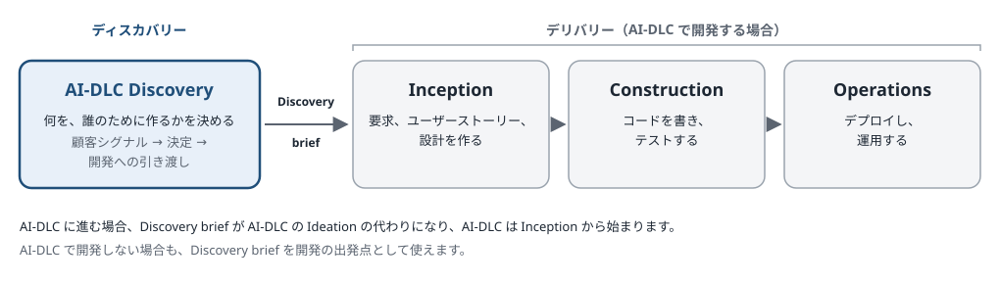
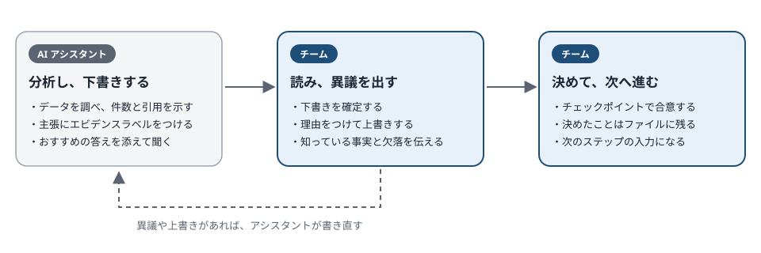
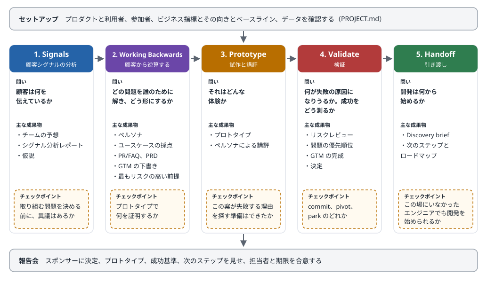
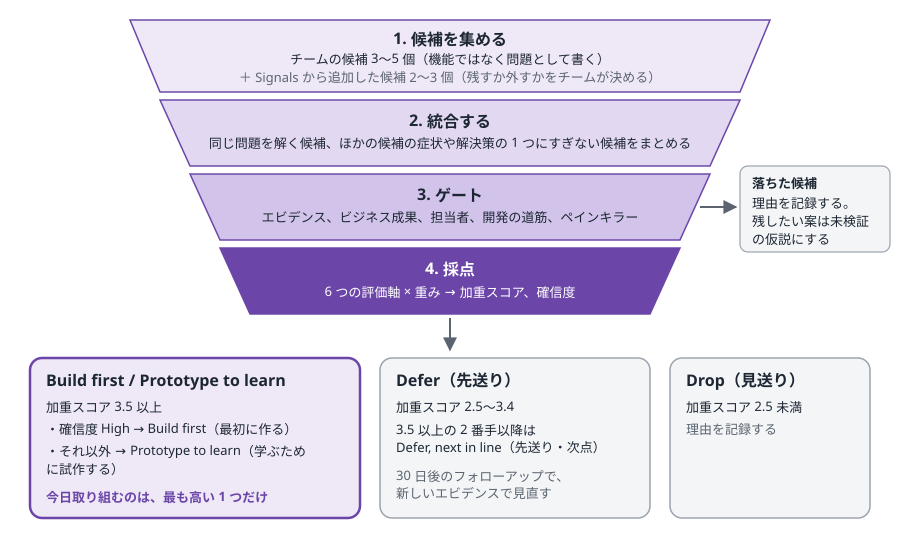
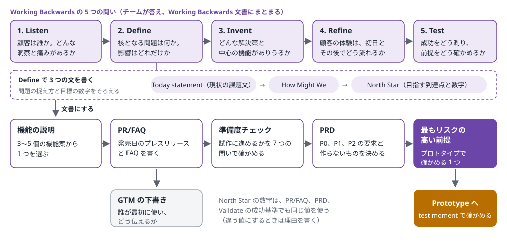
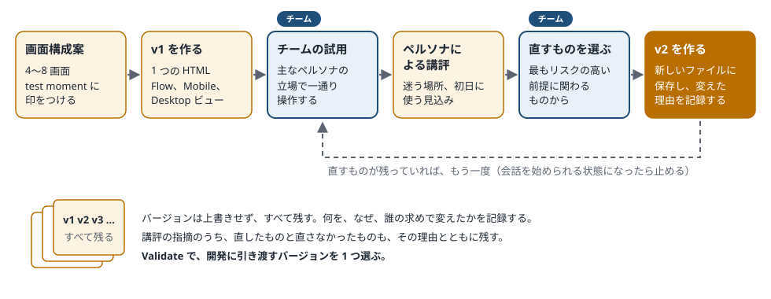
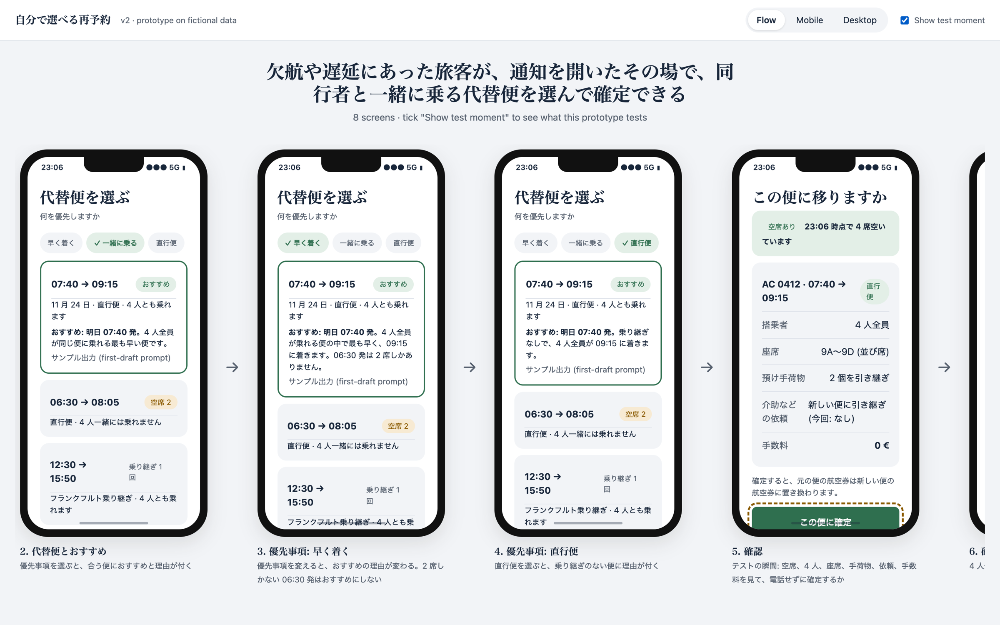
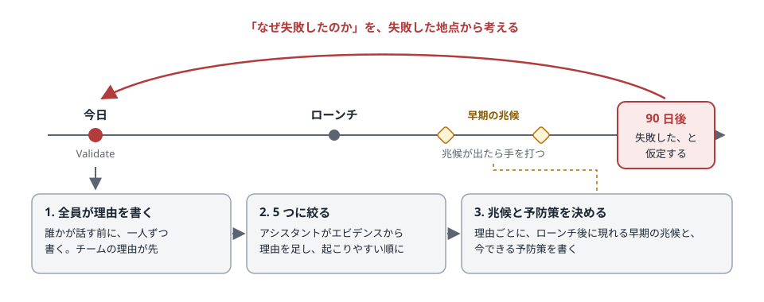
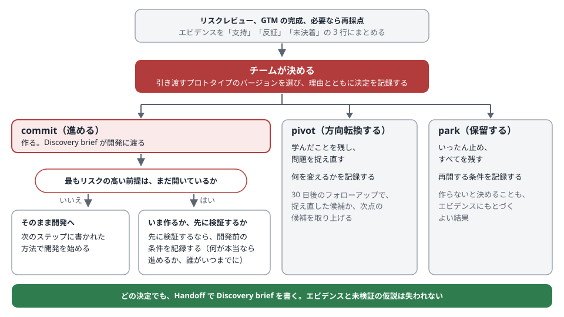
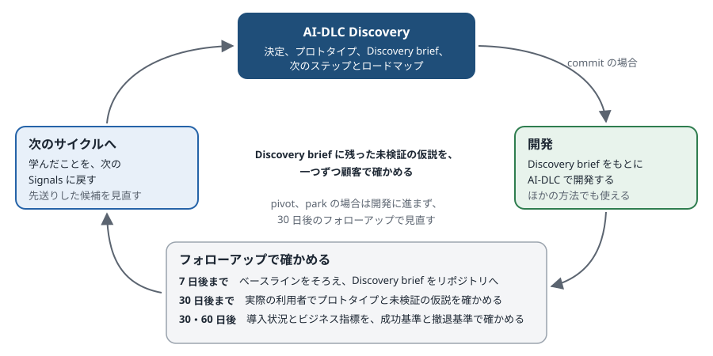

# 作る前に、プレスリリースを書こう。顧客の声から「最初に作るもの」を決める AI-DLC Discovery 入門

プロダクトマネジメントでは、プロダクト開発の仕事を「ディスカバリー」と「デリバリー」に分けて考えます（Marty Cagan『INSPIRED』）。ディスカバリーは、顧客が本当に必要としているものを見つけ、何を作るべきかを決める仕事です。デリバリーは、それを作って顧客に届ける仕事です。

AI コーディングアシスタントの登場で、デリバリーの速さは大きく変わりました。仕様が決まっていれば、画面もコードもテストも、以前より短い時間で形になります。けれど、デリバリーが速くなっても、ディスカバリーのやり方が変わらなければ、顧客に届く価値は増えません。何を作るかを、顧客の声ではなく、チームの思い込みや声の大きい人の意見で決めていれば、顧客が必要としていないものが、前より早くできあがるだけです。作り始めてから方向を変えるのは高くつき、開発が速いほど、間違った方向に進む距離も長くなります。

次のスプリントで作ろうとしている機能を思い浮かべてください。それを選んだ根拠を、顧客の言葉と数字で説明できますか。チームの全員が、同じ問題を同じ顧客のために解こうとしていますか。

AI-DLC Discovery は、このディスカバリーを、顧客の声に裏付けられたエビデンスにもとづいて行うための方法論です。皆さんのチームはワークショップの形で集まり、自分たちの顧客フィードバックを持ち寄って、「最初に何を作るか」を決めます。AI アシスタントが分析と下書きを引き受け、決めるのは皆さんです。終わるころには、操作できるプロトタイプと、開発がそのまま読み始められる 1 つの文書が手元に残ります。

**この記事で分かること**

- AI-DLC Discovery の目的と、AI-DLC との関係
- 参加者の役割と、ワークショップに持ち込むもの、持ち帰るもの
- 5 つのフェーズの流れと、それぞれの背景にある方法論
- 各フェーズで、参加者として何を考え、何を判断すればよいか
- ワークショップのあとに何をするか

## 1. AI-DLC Discovery とは

ディスカバリーでは、作る前に、顧客にとって価値があるか、使いこなせるか、作れるか、ビジネスとして成り立つかを確かめます。AI-DLC Discovery では、この確認を、チームが持ち込んだ実際の顧客フィードバックから始めます。チームは AI アシスタントと対話しながら、最初に取り組む問題を決め、プロトタイプで確かめ、開発に引き継ぐ文書を書きます。AI アシスタントには、AI-DLC Discovery の手順を組み込んだエージェントスキルを使います。スキルが分析と下書きの手順を受け持ち、各ステップで止まってチームに判断を求めます。

AI-DLC Discovery の目的は 3 つです。

1. 顧客のエビデンスにもとづいて、最初に取り組む問題を 1 つに決める。
2. 作る前に、顧客にとって価値があるか、使いこなせるかを安く確かめる。
3. 決めたことと、まだ分からないことを、開発が読める 1 つの文書にして渡す。

AI-DLC Discovery が扱うのは、誰の、どんな問題を、なぜ解くかです。アーキテクチャ、モデルの選定、データの設計、運用の準備は扱いません。それは開発の仕事です。

### AI-DLC への引き継ぎ

AI-DLC は、AI 駆動開発ライフサイクル（AI-Driven Development Lifecycle）の略です。AI-DLC については「[AI駆動開発ライフサイクル（AI-DLC）入門 ― 開発の未来を形づくる新しいアプローチ](https://builder.aws.com/content/3I4y1lREHN7C6CA0oS6zOgLh7jA/aiai-dlc)」で詳しく解説しています。AI-DLC Discovery の成果は、この AI-DLC に引き継ぎます。

*図 1-1: AI-DLC と AI-DLC Discovery の関係*

AI-DLC Discovery の終わりに、チームは Discovery brief（Handoff で作る、開発の出発点になる引き継ぎ文書）を書きます。AI-DLC は、この Discovery brief を唯一の入力として、要求、ユーザーストーリー、設計を作ります。Discovery brief が AI-DLC の Ideation の代わりになり、AI-DLC は Inception から始まります。Discovery brief は 1 つの Markdown 文書なので、AI-DLC で開発しない場合も、開発の出発点として使えます。

## 2. AI-DLC Discovery の基本的な進め方

5 つのフェーズのどこでも変わらない進め方を、先に説明します。

### AI が下書きし、チームが決める

AI アシスタントは、データを分析し、エビデンスをつけて下書きします。チームはそれを読み、確定するか、理由をつけて上書きするか、異議を出します。アシスタントはフェーズの終わりごとにチェックポイントで止まり、チームが進めると言うまで先に進みません。スコアも決定も、チームが確定するまでは下書きです。

*図 1-2: AI が下書きし、チームが決める*

下書きをそのまま受け入れると、それは AI の意見のままです。参加者の仕事は、「自分たちの顧客は本当にそうか」と問うことです。理由をつけた上書きは、よい結果です。

### すべての主張にエビデンスのラベルがつく

成果物の主張には、次の 3 つのラベルのどれかがつきます。

| ラベル | 意味 |
|--------|------|
| **Known**（データで裏付けあり） | 件数、引用、指標など、データが示している |
| **Assumed**（仮定） | そう考えているが、データでは示されていない |
| **Needs evidence**（要エビデンス） | 判断に関わるので、検証が必要 |

ラベルがあると、どこが分かっていて、どこが仮定なのかが一目で分かります。レビューで目を向けるべきなのは、**Assumed** と **Needs evidence** の主張です。仮定を隠さずに残すことで、開発が始まってから「それは誰が確かめたのか」と慌てることがなくなります。

### 質問には、おすすめの答えが付く

アシスタントの質問には、それぞれおすすめの答えが付きます。おすすめは、データや前のステップの成果物にもとづいて下書きされます。チームはゼロから考える必要がなく、おすすめを出発点にして、自分たちの判断を加えられます。データやファイルから分かる事実は、アシスタントが自分で調べます。チームに聞くのは、チームにしか決められないことです。ただし、分析の前にチームの予想を聞く質問には、答えを誘導しないように、おすすめが付きません。

また、いま答えられる質問は、まとめて聞かれます。おすすめどおりでよければ「はい」の一言で、一部だけ変えるなら「はい、ただし Q2 は〜」と、まとめて答えられます。

### 分かっていないことも成果になる

フェーズの終わりごとに、アシスタントは「分かっていること」「分かっていないこと」「仮定していること」を整理します。分かっていないことは、最後に未検証の仮説として Discovery brief に載り、開発への問いになります。ワークショップの中ですべてを確かめる必要はありません。何が分からないかを正直に残すことが大切です。

### 顧客データを丁寧に扱う

成果物の顧客の引用は匿名化されます。生のデータはバージョン管理に入れません。個人情報は、ワークショップの前に自分たちの環境で取り除いておきます（4 章）。

## 3. 参加者と役割

AI-DLC Discovery は、プロダクトの開発に責任を持つチームで行います。4〜6 人が目安です。人数が多い場合は、4〜5 人ずつのポッド（小グループ）に分かれ、ポッドごとに 1 つのユースケースを担当します。

| 役割 | 参加 | AI-DLC Discovery での役割 |
|------|------|---------------------------|
| プロダクトオーナー | 必須 | ビジネス指標とその向きを確かめます。取り組むユースケースと最後の決定に責任を持ち、ロードマップを受け取ります |
| エンジニアリングリード | 必須 | 実現可能性のスコアを決め、開発にとっての未知の点を挙げます。実現可能性のリスクを判定します |
| デザインの担当者 | 必要に応じて | プロトタイプの試用と講評で、使いやすさを判断します |
| データの担当者 | 必要に応じて | データの一覧と欠落を確かめ、ビジネス指標のベースラインを用意します |
| サポート、営業の担当者 | 必要に応じて | 顧客にいちばん近い立場から、ペルソナや顧客の声が実際の顧客に合っているかを確かめます。事業性の確認で、サポートと営業の懸念を挙げます |
| スポンサー | 最初と報告会 | 採点の重みを最初に決め、報告会で決定と次のステップを合意します |
| ファシリテーター | 全体 | 進行と時間を管理し、考えて決めるのがチーム自身であるようにします |

AI アシスタントへの入力は、1 人の操作担当者がまとめて行います。ほかの参加者は、画面を見ながら議論し、判断を伝えます。

役割ごとに、目を向けるリスクが違います。Marty Cagan は、顧客にとっての価値とビジネスとしての成り立ちはプロダクトマネージャー、使いやすさはデザイナー、実現可能性はエンジニアリングリードが責任を持つと整理しています（SVPG「The Four Big Risks」）。自分の役割から見て気になることは、遠慮せずに異議として出してください。

## 4. 持ち込むものと持ち帰るもの

AI-DLC Discovery は、チームが持ち込んだ実際のデータから顧客の声を抽出し、そのエビデンスにもとづいて判断します。データの質と、チームが持ち込む候補や指標の質が、そのまま結論の質になります。準備に時間をかけてください。

### 持ち込むもの

| 持ち込むもの | 内容 | 事前に考えておくこと |
|--------------|------|----------------------|
| 顧客データ | 本番データ、Signal Brief（匿名化したシグナルの要約）、合成データセットのいずれかです | どのチャネルのデータがあり、どのチャネルが欠けているか |
| テレメトリー（任意） | ジャーニーのステップごとの日次の集計です。生のログやトレースは持ち込みません | 顧客の行動を示すデータがあるか |
| 候補のユースケース 3〜5 個 | 機能ではなく、問題として書きます | その候補は、どの顧客のどの問題を解くのか |
| ビジネス指標とベースライン | 動かしたい指標と、その現在の値です。上がるとよいのか、下がるとよいのかも決めます | この取り組みで、どの数字をどれだけ動かしたいのか |

**データの扱い。** 組織のデータ取り扱いルールに従ってください。本番データに名前、メールアドレス、電話番号、アカウントの ID などが含まれる場合は、ワークショップの前に自分たちの環境で取り除きます。リポジトリの [`tools/prepare-data`](../../tools/prepare-data/README.md) は、そのための短い Python スクリプトで、オフラインで動きます。データをワークショップに持ち込めない場合は、自分たちの環境で顧客の問題ごとに 1 ページの Signal Brief を書き、それだけを持ち込みます。

ワークショップの中で AI アシスタントにデータを作らせることはしません。その場で作ったデータは、チームがいま言ったことをなぞるだけで、エビデンスになりません。

**候補のユースケースの書き方。** 1 つの候補を、次の 5 つの項目で書きます。

| 項目 | 書くこと |
|------|----------|
| 誰が困っているか | 顧客のセグメントや役割 |
| 問題 | その人が、どんな場面で、何に困っているか |
| エビデンス | チームがこの問題があると考える根拠 |
| ビジネス指標 | この問題を解くと動く指標 |
| 担当者 | チームの中で、開発に責任を持つ人 |

「問題」を書くときは、機能の名前を書かないようにします。たとえば「発注画面に AI のおすすめを追加する」は機能です。問題として書き直すと、「小規模店舗のオーナーは、週に一度の発注で何をどれだけ頼めばよいか分からず、在庫切れと余剰在庫を繰り返している」になります。問題として書いておくと、ほかの解決策と比べられます。

**チームの予想は、事前に共有しない。** 実際のワークショップでは、分析を見る前に、アシスタントが「データが何を示すと思うか」を聞きます。事前にチームで話し合うと、声の大きい人の予想に全員がそろってしまいます。一人ひとりが自分の考えを持って参加してください。

### 持ち帰るもの

| 持ち帰るもの | 内容 | 何に使うか |
|--------------|------|------------|
| 選んだユースケースについての決定 | 開発に進めるか（commit）、方向転換するか（pivot）、保留するか（park）と、その理由 | 次に何をするかを決める |
| プロトタイプ | 操作できる画面の試作。すべてのバージョンが残ります | 実際の利用者との会話を始める |
| Discovery brief | 決定、エビデンス、範囲、未検証の仮説をまとめた 1 つの文書です | 開発の出発点にする |
| 次のステップとロードマップ | 開発の始め方、フォローアップ、プロダクトオーナー向けの Now、Next、Later（今 / 次 / その後）のロードマップ | ワークショップのあとの行動を決める |

「作らない」と決めることも、よい結果です。park にした場合も、エビデンスと学んだことは Discovery brief に残り、次の機会に使えます。

## 5. 全体の流れ

AI-DLC Discovery は、セットアップのあと、5 つのフェーズを順に進みます。各フェーズは 1 つの問いに答えます。

*図 1-3: AI-DLC Discovery の全体の流れ*

| フェーズ | 問い |
|----------|------|
| Signals（顧客シグナルの分析） | 顧客は何を伝えているか |
| Working Backwards（顧客から逆算する手法） | どの問題を、誰のために、最初に解くか。それをどう形にするか |
| Prototype | それはどんな体験か |
| Validate（検証） | 何が失敗の原因になりうるか。成功をどう測るか |
| Handoff（引き渡し） | 開発は何から始めるか |

流れについて、知っておくとよいことがあります。

- **最初に、ビジネス指標を決める。** セットアップでは、プロダクトと利用者、参加者、ビジネス指標とその向きとベースライン、データを確認します。このあとのすべてのスコアは、この指標を基準につけられます。指標が違うと、選ぶ問題も変わります。
- **フェーズの終わりにチェックポイントがある。** チームが確認してから、次のフェーズに進みます。
- **前のフェーズの成果物が、次のフェーズの入力になる。** あとから前の決定を直したら、アシスタントはその影響を受けるステップのやり直しを提案します。
- **成果物はすべてファイルに残る。** 何回かに分けて進めても、続きから再開できます。
- **最後に報告会を開く。** スポンサーに、決定、プロトタイプ、成功基準、次のステップを見せ、担当者と期限を合意します。

ここからは、フェーズを 1 つずつ説明します。それぞれのフェーズで作る成果物の詳しい読み方とレビュー観点は、「[この PR/FAQ、本当に自分たちの言葉ですか？ AI-DLC Discovery で作る成果物の読み方](ai-dlc-discovery-artifacts.md)」で紹介します。

## 6. Signals: 顧客は何を伝えているか

Signals のねらいは、チームの思い込みを記録に残し、それをデータで確かめることです。

### 流れ

1. 分析を見る前に、チームの予想を一人ずつ聞く（任意。スキップしてもかまいません）。
2. データの一覧（どのソースから、何件、いつからいつまで、何が欠けているか）を確認する。
3. アシスタントがデータを分析し、シグナル分析レポートと仮説を書く。
4. 上位のシグナルと顧客の発言を読み、チームが異議を出す。

### 背景にある考え方

- **先に予想を書く。** AI のレポートを見たあとでは、自分がもともと何を信じていたかを正直に思い出せません。先に書いておくと、レポートは予想の一つひとつに「支持」「反証」「未決着」の判定をつけられます。役職の高い人の意見に場が流される HiPPO（Highest Paid Person's Opinion）を避けるため、予想は口数の少ない人から聞くのがコツです。
- **VoC（Voice of the Customer）分析。** フィードバックを 1 件ずつ読み、感情、カテゴリ、緊急度、根本原因の仮説、引用を取り出し、集計します。
- **件数より重さ。** よく出る話題が、いちばん重要とは限りません。レポートは、頻度、深刻度、到達範囲の 3 つで問題の大きさを見ます。
- **言うこととすること。** 顧客の発言と、顧客の行動はずれることがあります。テレメトリーがあれば、アシスタントは Say and do 表（顧客の発言とシステムの記録を並べた表）を作ります。この表では、顧客の問題のテーマごとに、それがフィードバックとテレメトリーのどちらに現れたかを、次の 3 つに分けます。

| テーマが現れた場所 | 意味 | 何を疑うか |
|------|------|------------|
| 両方に現れる | 顧客も言い、システムにも記録がある | 確かな問題。規模と影響を確かめる |
| フィードバックだけ | 顧客は言うが、システムには見えない | 計測していない場面がないか |
| テレメトリーだけ | システムには現れるが、顧客は言わない | 静かに離れている顧客がいないか |

- **反証できる仮説。** データが残した問いは、「〔誰〕は〔問題〕を抱えている、なぜなら〔原因〕」の形の仮説にし、検証の方法をつけます。

### 参加者が考えるべきこと

- データを見る前に、自分は顧客の何が問題だと思っているか。
- このデータには誰の声が入っていて、誰の声が入っていないか。自分が知っているデータの欠落はないか。いま挙げた欠落は、Discovery brief の未解決の問いとして残せます。
- 最も目立つエラーや、声の大きい要望が、そのまま上位になっていないか。エラーが多いことと、顧客が困っていることは同じではありません。「それで何人の顧客が止まったのか」と問います。
- 自分の予想が外れたとき、どこまでは正しかったか。外れた予想は、チームが学んだことの記録です。
- うまくいっているのはどこか。問題ばかり見ていると、守るべきものを見落とします。

予想とデータの照合は、たとえば次のようになります。

| チームの予想 | データが示したこと | 判定 |
|--------------|--------------------|------|
| E1. 解約の理由は、主に価格だと予想する | 解約時のコメントで価格に触れたものは 2 割ほど。多くは初期設定で止まったことに触れている | 反証 |
| E2. 法人の顧客ほど、レポート機能を求めていると予想する | 法人の問い合わせの上位にレポート機能がある | 支持 |
| E3. モバイルの利用者は、通知を嫌っていると予想する | 通知に触れたフィードバックが少なく、判断できない | 未決着 |

（表の内容は説明のための架空の例です。）

### このフェーズで作る成果物

| 成果物 | 何のために作るか |
|--------|------------------|
| チームの予想 | 分析前の思い込みを記録し、データと照らし合わせる |
| シグナル分析レポート | 上位の顧客の問題を、件数と引用つきで示す。このあとのすべての判断の根拠になる |
| 仮説 | データが残した問いを、検証の計画にする |

### チェックポイント

「何に取り組むかを決める前に、異議はありますか。」本物の異議が少なくとも 1 つ出るまで、先に進まないつもりで臨んでください。

## 7. Working Backwards: どの問題を、誰のために解き、どう形にするか

Working Backwards は、AI-DLC Discovery でいちばん大きなフェーズです。前半で「何に取り組むか」を決め、後半で「それを顧客にどう届けるか」を書きます。

### 前半: ペルソナとユースケースの採点

#### 流れ

1. データからペルソナを作る（3 人以上。いま満足している顧客を 1 人含める）。
2. 候補のユースケースを並べる。チームの候補に、Signals のテーマから 2〜3 個の候補が加わり、残すか外すかをチームが決める。
3. 採点の重みを確定する。
4. ゲートで候補を絞り、残った候補を 6 つの評価軸で採点する。
5. チームがすべてのスコアを確定または上書きし、取り組むユースケースを 1 つ選ぶ。

*図 1-4: ユースケースが絞られていく流れ*

#### 背景にある考え方

- **ペルソナ。** 利用者像を、具体的な 1 人の人物として描く手法です（Alan Cooper『The Inmates Are Running the Asylum』）。ここでのペルソナは、顧客データから作る合成ペルソナで、実在の顧客ではありません。ペルソナに満足している顧客を含めるのは、新しい機能が、いまうまくいっていることを壊さないかを確かめるためです。B2B のように選ぶ人と使う人が違う場合は、購買者とエンドユーザーのペルソナを分けます。購買者は価値と費用を、エンドユーザーは使い勝手を判断します。
- **ゲート: ユースケースの候補をふるい分ける。** 採点の前に、顧客のエビデンスがない、ビジネス指標につながらない、開発を担当する人がいない、開発の道筋がない候補を外し、理由を記録します。最後の基準がペインキラーテストです。出さなくても顧客が困らない、気づきもしない候補を外します。「痛み止め」のように、なければ顧客が困るものだけを残します。
- **加重スコアと確信度。** 6 つの評価軸に重みをかけて合計します。スコアとは別に、エビデンスの強さを確信度（High、Medium、Low）として持ちます。

| 評価軸 | 既定の重み | 何を見るか |
|--------|:----------:|------------|
| 顧客の痛み | 25 | どれだけ頻繁で、どれだけ深刻か。顧客は回避策にお金や手間をかけているか |
| ビジネス成果 | 25 | セットアップで決めた指標が、決めた向きに動くか |
| 到達範囲 | 15 | どれだけ多くの利用者、または価値の高いセグメントに届くか |
| 戦略との適合、または脅威 | 10 | 戦略の中心にあるか。競合や「何もしないこと」が顧客を失わせていないか |
| 実現可能性 | 15 | データと基盤がそろっているか。既存のプロダクトの上に作れるか |
| 導入の負担 | 10 | 利用者が、いまの使い方を大きく変えずに使えるか |

- **重みは先に固定する。** スコアを見てから重みを動かすと、推したい候補のための後付けの理屈になります。重みを変えるなら、採点の前にスポンサーと決めます。
- **1 チームに 1 つの焦点。** 加重スコアが 3.5 以上なら、確信度が High のとき Build first（最初に作る）、Medium か Low のとき Prototype to learn（学ぶために試作する）です。2.5〜3.4 は Defer（先送り）、2.5 未満は Drop（見送り）です。ワークショップで取り組むのは、最もスコアの高い 1 つだけです。価値は高いがエビデンスが弱い候補も、落とさずに「学ぶために試作する」に回ります。

#### 参加者が考えるべきこと

- このペルソナに会ったことがあるか。自分たちの顧客にいない人物になっていないか。
- いま満足している顧客は、新しい機能で何を失うか。
- 自分たちの候補は、機能か、問題か。
- その問題を解くと、セットアップで決めた指標が、決めた向きに動くか。候補が自分で選んだ指標で評価していないか。
- 実現可能性のスコアは、何があれば 2 点に下がり、何があれば 4 点に上がるか。これはエンジニアリングリードが答える問いです。その答えが、開発にとっていちばん大きな未知の点になります。
- 自分の推す案が先送りになるとき、スコアが見落としていることは本当にあるか。あるなら、理由をつけて上書きします。ないなら、声に出して先送りに同意します。

#### このフェーズで作る成果物

| 成果物 | 何のために作るか |
|--------|------------------|
| ペルソナ | 顧客を具体的な人として共有し、採点、PR/FAQ、プロトタイプの講評の基準にする |
| ユースケースの採点 | 取り組む問題を、エビデンスと理由つきで 1 つに決める |

### 後半: PR/FAQ、PRD、市場投入、最もリスクの高い前提

#### 流れ

1. Working Backwards の 5 つの問いに答える。
2. 機能案を 3〜5 個並べ、1 つを選ぶ。
3. PR/FAQ（Press Release / Frequently Asked Questions。発売時のプレスリリースと、想定される質問への回答をまとめた文書）を書く。
4. 準備度チェックで、プロトタイプに進める状態かを確かめる。
5. PRD（Product Requirements Document。製品要求仕様書）を書く。
6. 市場投入計画（GTM、go-to-market）を下書きする。
7. 最もリスクの高い前提（間違っていたらこの案が成り立たなくなる前提）を 1 つ決める。

5 つの問いにチームで答えてから PR/FAQ を書く進め方と、アシスタントが PR/FAQ のたたき台を先に書き、チームがそれに異議を出す進め方があります。どちらでも、最後に文書を自分たちのものにするのはチームです。

*図 1-5: Working Backwards の流れ*

#### 背景にある考え方

- **Amazon の Working Backwards。** 作る前に、発売日のプレスリリースと FAQ を書く手法です（Colin Bryar、Bill Carr『Working Backwards』）。顧客への価値を、発表できるほど明確に説明できないなら、作るべきではありません。技術や機能からではなく、顧客の体験から逆算して考えます。
- **問題を捉える 3 つの文。** 5 つの問いの 2 つ目（Define）で、次の 3 つの文を書きます。How Might We は、デザイン思考で広く使われる問いの立て方です。

| 文 | 型 | 確かめること |
|----|----|--------------|
| Today statement（現状の課題文） | いま、〔ペルソナ〕は〔場面〕で〔問題〕を抱えている。〔成果〕を得る方法が必要だ | 「方法が必要だ」の部分に、機能や技術ではなく、顧客が得る成果が書かれているか |
| How Might We（「どうすれば〜できるか」の問い） | どうすれば、〔ペルソナ〕のために〔成果〕を実現し、〔便益〕をもたらせるか | 複数の解決策が入る広さで、行動できる狭さか |
| North Star（目指す到達点） | 〔いつ〕までに〔能力〕を届け、〔指標 1〕と〔指標 2〕を動かし、〔目指す姿〕を実現する | 製品名ではなく能力を書いているか。数字がビジネス指標に結びついているか |

North Star の数字は、PR/FAQ、PRD、Validate の成功基準でも同じ値を使います。

- **7 段落のプレスリリース。** プレスリリースは、見出し、小見出し、7 つの段落で書きます。各段落の役割は 1 つです。顧客を主語にし、誇張表現を使いません。

| 段落 | 役割 |
|------|------|
| 1. 概要 | いつ、どこで、誰のために、何が出たか。読者がここで読むのをやめても伝わるように書く |
| 2. 課題 | 顧客のいまの状況と、その不便が顧客に何を失わせているか |
| 3. 解決策 | プロダクトがどう助けるかを、平易な言葉で |
| 4. リーダーの発言 | なぜこれが大切かを、提供する会社のリーダーの言葉で |
| 5. 顧客の体験 | きっかけから成果まで、顧客がたどる流れ |
| 6. 顧客の声 | ペルソナの言葉で語る感想（合成であることを明記する） |
| 7. 行動の呼びかけ | どこから始められるか |

- **準備度チェック。** PR/FAQ がプロトタイプに進める状態かを、7 つの問いで確かめます。判定は GREEN（すべて答えられる）、AMBER（欠落が 1〜3 個）、RED（欠落が 4 個以上）です。AMBER はよい結果で、GREEN を目指して時間を使う必要はありません。欠落は未検証の仮説として持ち越します。
- **P0 を小さくする。** PRD の要求は P0、P1、P2 に分けます。P0 は、プロトタイプにできる大きさに抑えます。何を作らないかも書きます。AI を使う機能なら、初版のプロンプトと、よい出力とは何かを示す評価用テストケースも作ります。
- **最もリスクの高い前提。** PR/FAQ と PRD の中の **Assumed** と **Needs evidence** の主張から、間違っていたらこの案が成り立たなくなるものを 1 つ選びます。Eric Ries が『リーン・スタートアップ』で「信じて飛ぶ前提（leap of faith assumptions）」と呼んだものに近い考え方です。
- **GTM の下書き。** 誰が最初に使い始めるか（ファーストアダプター）、どう位置づけて伝えるか（ポジショニング）、ビジネスモデルと価格の仮説、ローンチの段階を書きます。ポジショニングの文は、Geoffrey Moore『キャズム』の型を使います。比較の相手には、競合だけでなく「何もしない」ことも含めます。

#### 参加者が考えるべきこと

- このプロダクトが出たら、一日がよくなるのは誰か。それはチームやスポンサーではなく、顧客か。
- 根本原因は、「何が起きているか」ではなく「なぜ起きているか」を説明しているか。
- プレスリリースを声に出して読んで、自分たちの顧客に向けた、自分たちの言葉になっているか。違和感のある文は、その場で書き直します。
- 目標の数字を、自分たちの約束として声に出して言えるか。誰も声に出していない目標値は、誰も責任を持ちません。
- どの前提が間違っていたら、誰も使わないものを作ってしまうか。これは周りの意見に引きずられやすい判断なので、話し合う前に全員が一斉に選びます。
- どんな結果なら止めるか。合格ラインは、結果を見る前に決めます。結果を見てから決めた合格ラインは、結果に合わせて曲がります。
- 開発を止めてしまう未解決の問いに、担当者と期限がついているか。

#### このフェーズで作る成果物

| 成果物 | 何のために作るか |
|--------|------------------|
| Working Backwards 文書 | 5 つの問いの答えをまとめ、問題の捉え方と目標の数字をそろえる |
| 機能の説明 | 解決策の候補から 1 つを選ぶ |
| PR/FAQ | 顧客への価値を、発表できる形で書く。準備度チェックと、プロトタイプで見せる範囲を含む |
| PRD | 何を作り、何を作らないかを決める |
| GTM（下書き） | 誰が最初に使い、どう伝えるかを決める。Validate で完成させる |
| 最もリスクの高い前提 | プロトタイプで確かめることを 1 つに絞る |

### チェックポイント

「プロトタイプで何を証明する必要がありますか。」答えは、最もリスクの高い前提を確かめる場面になるはずです。

## 8. Prototype: それはどんな体験か

Prototype のねらいは、操作できるプロトタイプを作り、講評を受け、少なくとも一度変えることです。文書をもう 1 本書くより、触れるものに反応するほうが多くを学べます。

### 流れ

1. 4〜8 画面の画面構成案を作り、test moment（前提を検証する場面）に印をつける。
2. アシスタントが、1 つの HTML ファイルでプロトタイプを作る。全体を見渡す Flow、スマートフォンの Mobile、ブラウザーの Desktop の 3 つのビューがあります。
3. チームが、主なペルソナの立場で一通り操作する。
4. 各ペルソナが、自分の立場でプロトタイプを講評する。
5. チームが直すものを選び、アシスタントが新しいバージョンを作る。

*図 1-6: プロトタイプのイテレーション*

できあがるプロトタイプは、たとえば次のようなものです。

*図 1-7: AnyCompany Air のサンプルで作ったプロトタイプの例（Flow ビュー）。架空の航空会社のデータで作ったもので、実際のワークショップでは皆さんのプロダクトの画面になります。点線で囲まれたボタンが test moment です。*

### 背景にある考え方

- **学ぶためのプロトタイプ。** 完成品を作るのではなく、最もリスクの高い前提を確かめるのに必要な最小の流れを作ります。会話を始められる状態になったら、それ以上は作り込みません。
- **ペルソナの立場で画面をたどる。** 利用者の立場で画面を順にたどり、迷う場所、止まる場所を探します。ユーザビリティ評価の認知的ウォークスルーに近い考え方です。チームの最初の試用では「よさそうです」で終わることが多く、引用にもとづいたペルソナの講評が、チームの見落とした問題を見つけます。
- **講評は仮説。** ペルソナは合成されたもので、その反応は顧客のエビデンスではありません。実際の利用者による検証は、ワークショップのあとに行います。

### 参加者が考えるべきこと

- test moment で、最もリスクの高い前提が本当に見えるか。
- 主なペルソナなら、どこで迷い、どこであきらめるか。
- 画面が示していることのうち、誰も確認していないことはどれか。たとえば「座席を確保しておける」「すぐに通知が届く」といった画面上の表現は、プロトタイプの中では約束に見えます。本当にできるかを、知っている人に確かめます。分からなければ **Needs evidence** として残します。
- アシスタントが、チームの合意から変えたところはないか。あれば、このままにするか戻すかを決めます。
- どの指摘を直すか。最もリスクの高い前提に関わるものから選び、次に手間の少ないものを直します。色やデザインの細部に時間を使いません。

### このフェーズで作る成果物

| 成果物 | 何のために作るか |
|--------|------------------|
| プロトタイプとそのバージョン | 議論できる具体物にし、何をなぜ変えたかを残す |
| ペルソナによる講評 | 価値と使いやすさのリスクを判断するエビデンスにする |

### チェックポイント

「ペルソナが言ったことと、私たちが変えたことはこれです。この案が失敗する理由を探す準備はできましたか。」次の Validate では、改善したプロトタイプをもとに、この案がうまくいかない理由を探します。

## 9. Validate: 失敗するとしたら、なぜか

Validate のねらいは、この案が失敗することを証明しようとしてみてから、決めることです。使うのは、すでに手元にあるデータ、ペルソナ、プロトタイプだけです。アンケートの結果は待ちません。ワークショップの中で決着しないことは、未検証の仮説として開発に渡します。

### 流れ

1. 改善したプロトタイプを、ペルソナの立場でもう一度たどる。
2. 4 つのリスクを、それぞれエビデンスで判定する。
3. プレモーテムで、失敗の理由を挙げる。
4. 成功基準を決める。
5. 顧客の問題に優先順位をつける。
6. GTM を完成させる（事業性の確認、導入と成功の表）。必要ならユースケースを再採点する。
7. 引き渡すプロトタイプのバージョンを選び、commit、pivot、park を決める。

### 背景にある考え方

- **4 つのリスク。** Marty Cagan は、プロダクトのリスクを 4 つに整理しています（SVPG「The Four Big Risks」、『INSPIRED』第 2 版）。AI-DLC Discovery では、それぞれを次のエビデンスで判定します。

| リスク | 問い | 主なエビデンス |
|--------|------|----------------|
| 価値 | 顧客は、いまのやり方を変えるほど、これを求めるか | ペルソナによる講評、Signals の頻度と深刻度 |
| 使いやすさ | 各ペルソナが、助けなしで主な流れを終えられるか | ペルソナによる講評と、改善後のバージョンの再確認 |
| 実現可能性 | チームのデータ、プロダクト、基盤で作る道筋があるか | エンジニアリングリード、PRD の依存関係。アーキテクチャではなく未知の点を挙げる |
| 事業性 | ビジネスとして成り立つか | GTM の事業性の確認（法務、プライバシー、営業、サポート、マーケティング） |

- **プレモーテム。** 計画が失敗したと仮定して、その原因を先に挙げる手法です（Gary Klein「Performing a Project Premortem」、Harvard Business Review、2007 年）。「失敗するかもしれない」と言うのは気が引けますが、「すでに失敗した」と仮定すると、懸念を口にしやすくなります。

*図 1-8: プレモーテムの考え方*

- **成功基準と撤退基準。** 成功基準は、何を測るか、ベースライン、目標、いつ確かめるか（30、60、90 日後）をそろえて書きます。撤退基準は、「いつまでに、どの数字に届かなければやめる」という形にします。あいまいな撤退基準は、いつまでも発動しません（Annie Duke『Quit』）。
- **commit、pivot、park。** Eric Ries が『リーン・スタートアップ』で示した「方向転換か、継続か」の判断に近いものです。最もリスクの高い前提がまだ開いている場合は、いま作るか、先に検証するかも選びます。

*図 1-9: commit、pivot、park の判断*

### 参加者が考えるべきこと

- リリースの 90 日後にこれが失敗したとしたら、理由は何か。ほかの人が話す前に、自分の理由を書いたか。
- すべてのリスクが「支持」になっていないか。満足しているペルソナが失うものは何か。
- 自分の役割が責任を持つリスク（3 章）を、自分の言葉で判定できるか。
- 成功基準は、何を測るか、閾値、誰が確かめるか、いつ確かめるかがそろっているか。Working Backwards で決めた目標の数字と矛盾しないか。見栄えのよいだけの指標になっていないか。
- 最もリスクの高い前提がまだ開いているなら、いま作るのか、先に検証するのか。先に検証するなら、何がどうなれば進めるのか。
- アシスタントがチームの代わりに書いたもの（理由、中間目標、撤退基準、担当者）を、自分たちの決定として開発に渡してよいか。違うなら、変えるか、提案だと明記します。

### このフェーズで作る成果物

| 成果物 | 何のために作るか |
|--------|------------------|
| リスクレビュー | 4 つのリスク、プレモーテム、成功基準をまとめ、決定の根拠をそろえる |
| 問題の優先順位 | 顧客の問題のバックログと、未検証の仮説を残す |
| GTM（完成） | 事業性の懸念と、導入と成功をどう測るかを決める |
| 決定 | commit、pivot、park と、その理由と条件を残す |

### チェックポイント

「commit、pivot、park のどれにしますか。理由は何ですか。」

## 10. Handoff: 開発は何から始めるか

Handoff のねらいは、決めたこととその根拠、まだ分からないことを、開発に渡せる形にすることです。

### 流れ

1. 必要な成果物がすべてそろっているかを確かめる。
2. 開発の進め方を確かめる（AI-DLC で開発するか、ほかの方法で開発するか、開発しないか）。
3. Discovery brief を書く。
4. 次のステップと、プロダクトオーナー向けのロードマップを書く。

### 背景にある考え方

- **1 つの文書で渡す。** Discovery brief は、AI-DLC Discovery に参加していない人や AI-DLC が読んで、作業を始められる文書です。決定、問題とエビデンス、ペルソナ、範囲、プロトタイプの画面と流れ、未検証の仮説など 15 の節があり、詳細は各成果物へのリンクで示します。アーキテクチャや技術の選定は書きません。
- **Now、Next、Later のロードマップ。** 日付ではなく、条件で並べるロードマップです（Janna Bastow が広めた形式）。各項目は、顧客の問題と、それが動かす指標で書きます。AI-DLC Discovery で出てこなかった新しいアイデアは足しません。

| 区分 | 何が入るか | 各項目に書くこと |
|------|------------|------------------|
| Now（今） | 今回取り組むユースケース | 開発前の条件と、成功基準 |
| Next（次） | 先送りした候補 | 順位を上げるエビデンス、それを集める人、どのフォローアップまでか |
| Later（その後） | それ以外の候補 | 後に回す理由。ゲートで落ちた候補を戻しうる仮説 |

### 参加者が考えるべきこと

- この場にいなかったエンジニアが、この Discovery brief だけで作業を始められるか。
- チームが決めていないことが、決めたこととして書かれていないか。
- 未検証の仮説が、開発への問いとして書かれているか。
- 先送りした候補は、どんなエビデンスがあれば次に上がるか。それを誰が集めるか。

### このフェーズで作る成果物

| 成果物 | 何のために作るか |
|--------|------------------|
| Discovery brief | 決定、エビデンス、範囲、未検証の仮説を、開発に渡す |
| 次のステップとロードマップ | 開発の始め方とフォローアップを、チャットではなく文書に残す |

### チェックポイントと報告会

Handoff の最後に、アシスタントは振り返りたいフェーズがないかを確かめます。そのあと報告会で、スポンサーに決定、プロトタイプ、成功基準、次のステップを見せます。「なぜ自分が信じていたことをやらないのか」と聞かれたら、意見ではなく Signals のエビデンスで答えます。報告会は、名前と期限を合意して終えます。

## 11. ワークショップのあと

ワークショップの中で、すべてを確かめられるわけではありません。Discovery brief に残った未検証の仮説を、日を追って確かめていきます。日数は目安です。

*図 1-10: AI-DLC Discovery のサイクル*

- **7 日後まで:** ビジネス指標のベースラインがなかった場合は、ここでそろえます。Discovery brief を、開発するリポジトリに入れます。次のステップの担当者が動き始めます。
- **30 日後まで:**
  - 実際の利用者にプロトタイプを試してもらいます。ワークショップで講評したペルソナは合成されたものなので、ここが初めての本物の検証です。
  - 未検証の仮説を、実際の顧客で確かめます。リポジトリには、仮説からアンケートを作り、回答を読み込んで仮説ごとに判定するスキル（`discovery-survey`）もあります。
  - 先送りした候補を、新しいエビデンスで見直します。
- **開発を始める:**
  - AI-DLC で開発する場合は、次のステップに書かれたコマンドで AI-DLC を始めます。AI-DLC は Discovery brief を唯一の入力として、要求、ユーザーストーリー、設計を作ります。
  - AI-DLC で開発しない場合も、Discovery brief を開発の出発点の文書として使えます。
  - pivot や park にした場合は、30 日後のフォローアップで見直します。
- **30 日後と 60 日後:** 導入状況とビジネス指標を、GTM に書いた成功基準と撤退基準に照らして確かめます。
- **次のサイクルへ:** 学んだことを、次の Signals に戻します。顧客から学び続ける習慣を、Teresa Torres は『Continuous Discovery Habits』で継続的ディスカバリーと呼んでいます。AI-DLC Discovery は 1 回で終わるものではなく、繰り返すたびにエビデンスが増えていきます。

## まとめ

- AI-DLC Discovery は、顧客のエビデンスから「最初に作るもの」を決め、開発の出発点になる Discovery brief を作る方法論です。チームはワークショップの形で進めます。
- AI アシスタントが分析と下書きを引き受け、チームが異議を出し、上書きし、決めます。
- 5 つのフェーズは、顧客の声を聞き（Signals）、顧客から逆算して書き（Working Backwards）、触れるもので試し（Prototype）、壊そうとしてから決め（Validate）、開発に渡す（Handoff）流れです。
- 分からないことは、未検証の仮説として正直に残し、ワークショップのあとに確かめます。

ワークショップで持ち帰るのは、答えと、まだ答えの出ていない問いです。Discovery brief に残った未検証の仮説を、一つずつ顧客に確かめていきましょう。

各フェーズで作る成果物の読み方とレビュー観点は、「[この PR/FAQ、本当に自分たちの言葉ですか？ AI-DLC Discovery で作る成果物の読み方](ai-dlc-discovery-artifacts.md)」で紹介します。

## 用語集

AI-DLC Discovery の画面と成果物には、英語のまま表示される用語があります。

| 用語 | 意味 |
|------|------|
| Signals、Working Backwards、Prototype、Validate、Handoff | 5 つのフェーズの名前 |
| Known / Assumed / Needs evidence | エビデンスラベル。データで裏付けあり / 仮定 / 要エビデンス |
| Signal Brief | 顧客の問題ごとに 1 ページにまとめた、匿名化したシグナルの要約 |
| Say and do 表 | 顧客の発言とシステムの記録を並べた表 |
| Build first / Prototype to learn / Defer / Drop | ユースケースの決定。最初に作る / 学ぶために試作する / 先送り / 見送り |
| Today statement / How Might We / North Star | 現状の課題文 / 「どうすれば〜できるか」の問い / 目指す到達点 |
| PR/FAQ | 発売時のプレスリリースと、想定される質問への回答をまとめた文書 |
| PRD | 製品要求仕様書。要求を P0、P1、P2 に分けて書く |
| GTM | 市場投入計画（go-to-market） |
| GREEN / AMBER / RED | 準備度チェックの判定 |
| test moment | プロトタイプの中で、最もリスクの高い前提を検証する場面 |
| commit / pivot / park | 決定。進める / 方向転換する / 保留する |
| Discovery brief | Handoff で作る、開発の出発点になる引き継ぎ文書 |
| Now / Next / Later | ロードマップの区分。今 / 次 / その後 |

## 参考文献

- Marty Cagan『INSPIRED: How to Create Tech Products Customers Love』第 2 版、Wiley、2017 年
- Marty Cagan「The Four Big Risks」、SVPG、2017 年 <https://www.svpg.com/four-big-risks/>
- Gary Klein「Performing a Project Premortem」、Harvard Business Review、2007 年 9 月号 <https://hbr.org/2007/09/performing-a-project-premortem>
- Colin Bryar、Bill Carr『Working Backwards: Insights, Stories, and Secrets from Inside Amazon』、St. Martin's Press、2021 年
- Alan Cooper『The Inmates Are Running the Asylum』、Sams、1999 年
- Eric Ries『リーン・スタートアップ』、日経 BP、2012 年（原著『The Lean Startup』、2011 年）
- Geoffrey A. Moore『キャズム』、翔泳社（原著『Crossing the Chasm』）
- Annie Duke『Quit: The Power of Knowing When to Walk Away』、Portfolio、2022 年
- Teresa Torres『Continuous Discovery Habits』、Product Talk、2021 年
- AI-DLC Discovery のリポジトリ <https://github.com/aws-samples/sample-aidlc-discovery>
- AI-DLC のリポジトリ <https://github.com/awslabs/aidlc-workflows>
